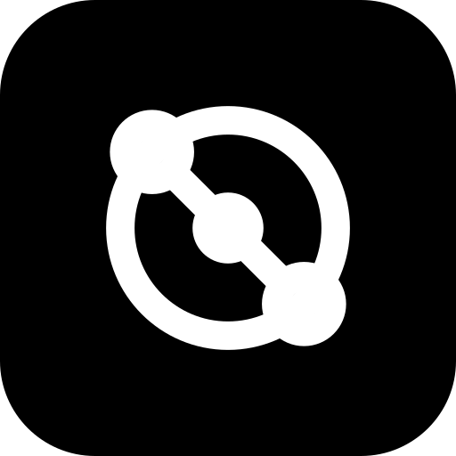

# Nexul

> One loop from docs to deploy, on servers you own.

[](https://github.com/otal-labs/nexul/actions/workflows/ci.yml)
[](LICENSE)
[](https://nexul.io/docs/)
[](go.mod)

> [!WARNING]
> Nexul is in beta. Expect rough edges and breaking changes between releases.

Nexul is a self-hosted workspace for teams that ship with coding agents. Docs,
tickets, chat, CI runners, and deploys to your own servers sit in one app, and
one MCP server exposes all of it, so an agent uses the same tools people do.

## Alternative to

| Area | Instead of |
|---|---|
| Project management | Linear, Jira |
| Docs | Notion, Confluence |
| Chat and calls | Slack, Discord |
| Deploys | Heroku, Vercel, Netlify, Render |
| CI runners | GitHub Actions self-hosted runners |
| The agent layer | One MCP server over everything above, not an agent bolted onto each tool |

Phew, that is a lot of tabs to close.

## Where the idea comes from

- [mattpocock/skills](https://github.com/mattpocock/skills): grill an idea
  against the docs and a board of scoped tickets falls out in one sitting.
- [pingdotgg/t3code](https://github.com/pingdotgg/t3code): once an agent does
  the typing, running several pieces of work in parallel is natural, and that
  changes how code should be written.
- [pstack](https://github.com/cursor/plugins/tree/main/pstack), Lauren Tan's
  engineering-discipline pack: short principles and playbooks go a long way
  when an agent checks its own work against them.

Nexul applies all three to the whole loop, from the doc to the deploy.

## The core idea

Docs, tickets, code, reviews, deploys, server topology, and run logs are
linked and searchable in one place, so an agent can run the whole loop
without leaving it.

```
docs      land the idea; unclear? run the /wayfinder or /grill-with-docs play
tickets   derived from the docs, each one scoped
work      a person or an agent, the owner's choice
PRs       linked back to the ticket and the doc
review    linked and indexed
deploy    a runner executes it, the topology updates live
index     the next loop starts with full context
```

Each step is a use case. The web app reaches it through the HTTP gateway and
agents reach it through MCP, so both run the same code. A personal access
token carries its user's permissions, and its calls are recorded as that user.

## Who it's for

- Solo developers and small teams who self-host: one install command, native
  services on one port, no managed services.
- Teams running coding agents that need a tracker, docs, and deploys a machine
  can query and act on.
- Operators deploying to ordinary servers who want a live topology view
  without Kubernetes.

## Functions

Everything below is in the AGPL edition and runs on your own servers. The
[guide](https://nexul.io/docs/guide/) covers each area.

| Domain | Done | Summary |
|---|:---:|---|
| Workspaces and projects | ✅ | One instance, many workspaces, each with its own projects, members, and settings. A project owns its docs, board, and repositories. |
| Docs | ✅ | Rich text with version history, named versions, `@` mentions, attachments, and markdown import and export. Tickets derive from docs, and each doc has one thread for discussing its work. |
| Live collaboration | ✅ | Several people edit a doc at once with live cursors. The UI updates over WebSockets without a refresh. |
| Tickets and the board | ✅ | A Kanban board per project with configurable statuses in five fixed stages, ticket types, labels, and swimlanes. A ticket is finished once a linked PR merges and none are still open. |
| Chat | ✅ | Channels, direct messages, and one thread per ticket and per doc. Mention a person or `@Agent`; the events you care about land in an inbox. |
| Voice | ✅ | Voice rooms with screen share and camera on your own LiveKit server, each with its own text chat. |
| Plays | ✅ | One-button agent runs from a ticket or doc ("Fix with AI", "To tickets via AI"). A run uses your paired coding harness and your permissions, and its transcript lands in the thread as a trail you can read, stop, or answer. |
| Memories | ✅ | Versioned notes for agents, per project. Agents can write them too, and every agent turn gets the index. |
| Code review | ✅ | Each linked PR's review state, shown on the ticket. Review threads stay on the Git host. |
| Git providers | ✅ | GitHub through a GitHub App: repositories, branches, pull requests, and webhooks. |
| Stacks and deploys | ✅ | A repository becomes a stack (a compose file, or a single Dockerfile) that a runner deploys with `docker compose up`. History, cancel, one-click rollback, a preview deployment per branch, and import of containers already running on a machine. |
| Runners and machines | ✅ | A small service on each machine dials out over a WebSocket, so the server holds no SSH keys. One command installs a named runner; several can share a machine, each with its own credential. Work queues until a runner connects. |
| Topology | ✅ | A canvas of every service, network, gateway, and hostname, with each node's status as its runner last saw it. |
| DNS and exposure | ✅ | Cloudflare zones and records, tunnels for hosting with no open ports, and gateways that expose one hostname to one container. |
| Automations | ✅ | Event-driven TypeScript on `@otal-labs/nexul-sdk`, run on the bundled host or on one you place on any machine. Each automation has its own scoped token and reads a shared secrets pool. |
| Connectors and integrations | ✅ | Instance-wide credentials for GitHub, Cloudflare, and LiveKit. Integrations get scoped tokens, signed outgoing webhooks, and an OpenAPI 3 spec at `/openapi.json`. |
| Access | ✅ | Invitation links, OAuth sign-in, custom roles per workspace, per-user permission overwrites, and personal access tokens, all checked against one `<domain>:<action>` vocabulary. |
| Search | ✅ | Full-text search over docs, tickets, and ticket notes, from the docs page, the API, and MCP. |
| MCP server | ✅ | Task-shaped tools on the official MCP Go SDK, plus resources and workflow prompts, over stateless Streamable HTTP at `/mcp`. Tools are marked read-only or destructive, lists are paged, and errors say what the agent should fix. |
| Logs | ✅ | Server logs go to the OpenObserve that `nexul install` sets up (at `/openobserve/` on the same port) or to any OTLP/HTTP backend. Browser console errors join the same stream. |
| Desktop app | ✅ | An Electron shell that imports connection tokens, keeps a list of instances, and loads the one you pick. |
| Instance upgrade | ✅ | Settings shows the running and newest versions. One click (or the `instance_upgrade` tool) upgrades every Nexul service on the server. |
| Call notes | ⬜ | A speech-to-text model takes notes on a voice call and writes the summary into the doc. |

## Contributing

Go (version in `go.mod`) and Bun are the only prerequisites. Start with
[`CONTRIBUTING.md`](CONTRIBUTING.md); the
[contributor docs](https://nexul.io/docs/contributing/) have the rest.
[`AGENTS.md`](AGENTS.md) is written for coding agents and reads fine for
people. [`ROADMAP.md`](ROADMAP.md) is where the product is going,
[`.scratch/`](.scratch/) holds the open specs and tickets, and
[`CONTEXT.md`](CONTEXT.md) is the vocabulary.

## License

Nexul is open core: one repository, two licenses.

- Everything outside `ee/` is AGPL-3.0-or-later. Run it, change it, and
  self-host it at any company size. If you offer a modified copy over a
  network, publish your changes.
- Everything inside `ee/` is under a commercial license (`ee/LICENSE`). You
  can read and patch it, but running it in production needs a subscription.
  Today the directory holds only the license.

Outside contributions need the [Contributor License Agreement](CLA.md) so the
project can keep licensing both parts. Tick the box in the pull request
template to agree.

### Enterprise Edition (EE)

What the subscription will include.

| Feature | Done | Summary |
|---|:---:|---|
| Cloud hosting | ⬜ | A managed control plane we run. Your runners and servers stay yours. |
| SSO | ⬜ | OIDC and SAML sign-in (Google, Microsoft Entra, Okta) with just-in-time user provisioning. |
| External secrets | ⬜ | Read secrets from Vault, 1Password, or a cloud secrets manager instead of storing them in Nexul. |
| Priority support | ⬜ | A response-time SLA and a direct channel. |
